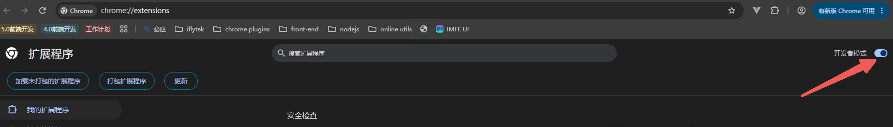
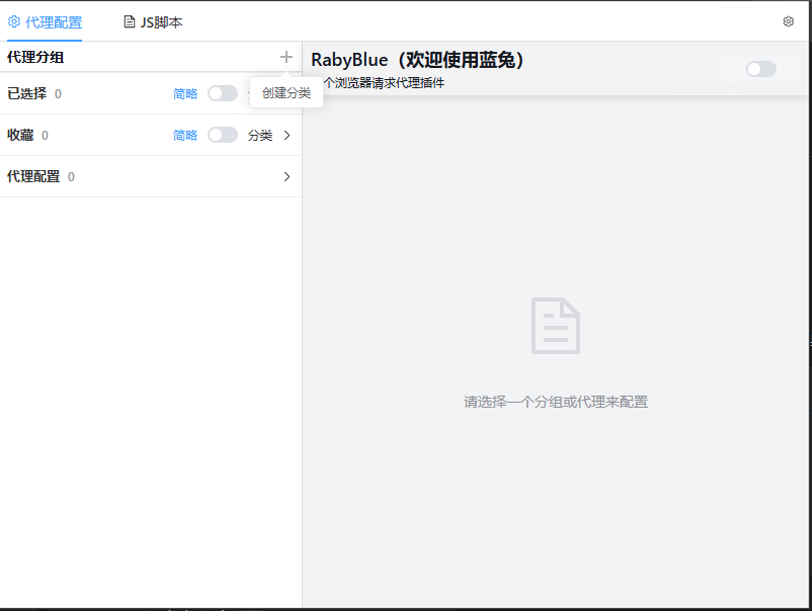
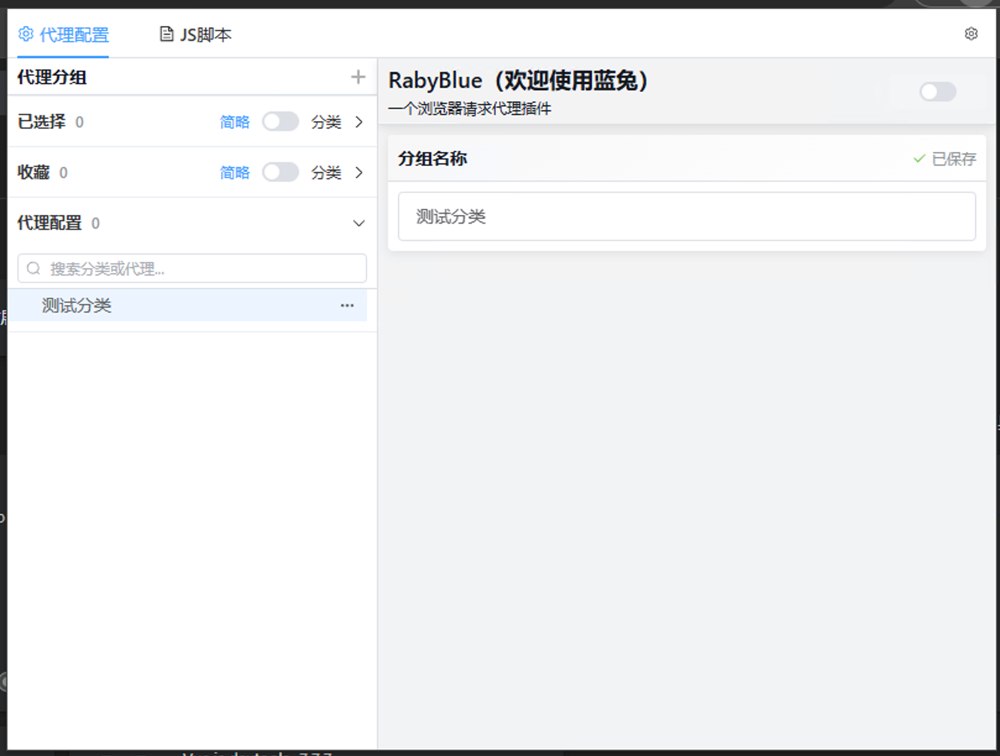
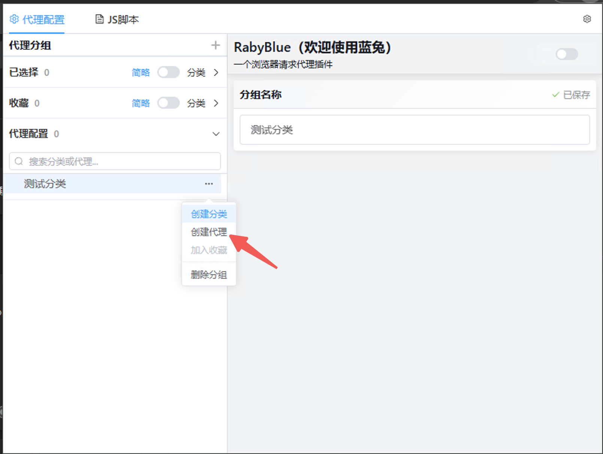
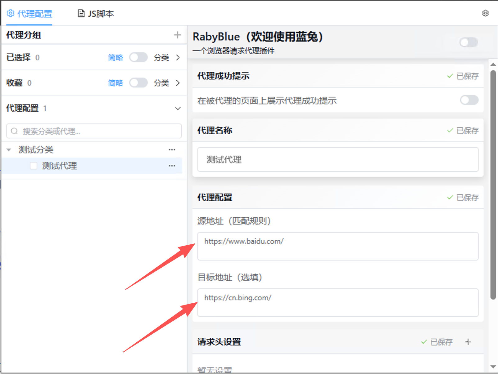
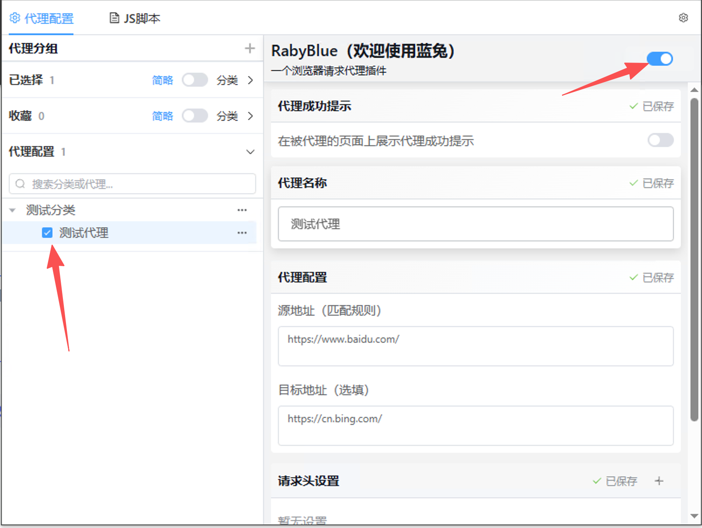
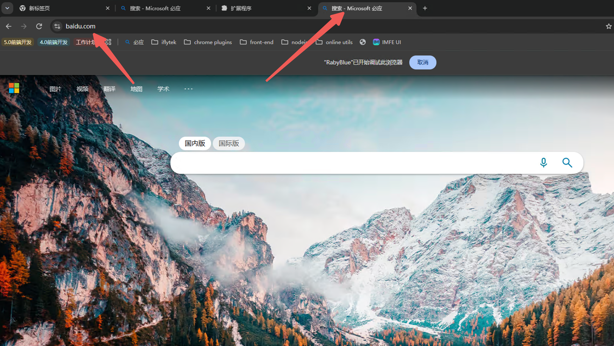

# Hi Guys 欢迎使用蓝兔

是的，是你想的那个蓝兔，虹猫正在开发中...

## 蓝兔是什么？

蓝兔是一个浏览器代理插件，为WEB研发调试而生！
当然，您可以使用蓝兔做您想做的任何事情，蓝兔全心全意为您服务～

## 蓝兔解决哪些问题？
试想以下场景：
- 前端项目使用微前端构建了一个巨石应用，一个基座下挂10+、20+的子应用。应用还没启动几个，电脑内存就开始直呼吃不消，烦！
  要是能做到我修改哪个服务我启动哪个服务，我不改的全走线上环境就好了～

- 后端项目使用微服务，本地的服务注册到nacos之后不是要改请求地址就是要给请求增加自定义header才能将服务转发到本地，这两个操作都得改代码，调试完了还得改回去，麻烦不说还总是忘，烦！
  要是能不改代码就能替换请求地址，或者给制定的请求增加自定义请求头就好了～

- 线上出问题了，同事给了控制台报错，看半天不知道错在哪（生产环境关闭sourcemap，错误信息、调用堆栈显示的都是压缩过的内容），烦！
  要是能直接访问线上的地址，使用本地代码就好了～

- 线上问题修复之后，开发环境还没有数据测试，想造数据业务流程比印度火车都长，烦！
  要是能直接使用线上环境数据验证就好了～ （不建议这么懒哦，该造数据还是得造的[旺柴]～）

- 我是测试我的研发同事总说“我本地好的很啊，怎么就你那有问题？” 之类的甩锅言语，烦！
  要是能接到他本地用他的代码来跑就好了～（需内网）

- 我有两台电脑，一台跑后端一台跑前端，每次都需要改代码才能让前端请求本地的后端，烦！
  要是能不改代码就能请求我的后端服务就好了～（需内网）

上面这些内容但凡**有一条与您情况相符，蓝兔就能全心全意为您服务**， 蓝兔可以

  1. 通过配置，将请求向**源地址**的请求**重定向**到配置中的**目标地址**
  2. 通过配置，将符合**源地址**的请求**增加/修改请求头/响应头**
  3. 蓝兔可以导出/导入您的代理配置，**方便您向周围的同事分享**代理配置
  4. 蓝兔会始终**在您的本地记录**您的使用习惯，会记录您勾选的代理、总控开关，甚至您折叠起的面板

## 我该如何使用蓝兔？
1. 访问chrome拓展程序页 [chrome://extensions/](chrome://extensions/)
2. 打开chrome拓展程序**开发者模式**
   
3. 将本仓库的的dist文件拖拽入拓展程序页即可完成安装
4. 点击RabyBlue图标，打开弹窗配置您的代理即可使用
   
   
   
   
   
   
## 蓝兔是如何实现的？
