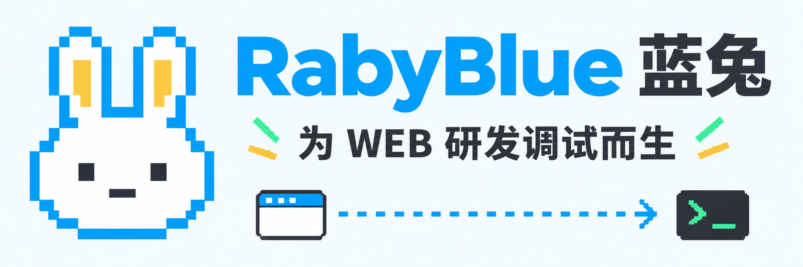
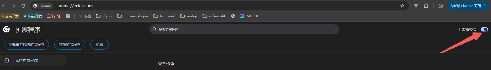
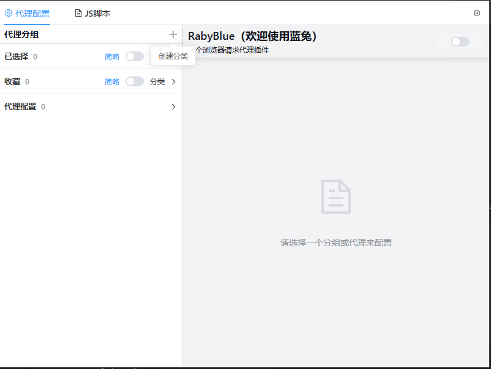
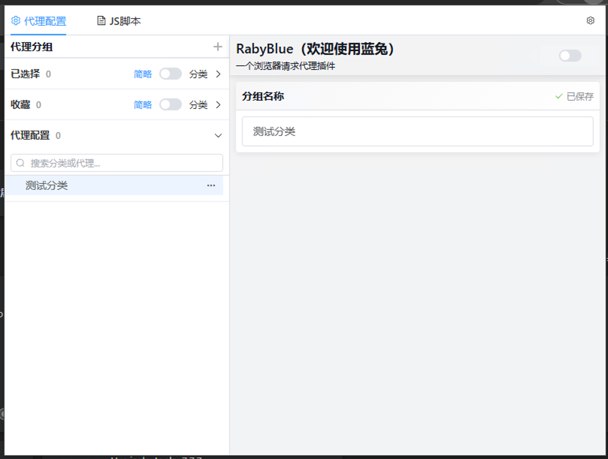
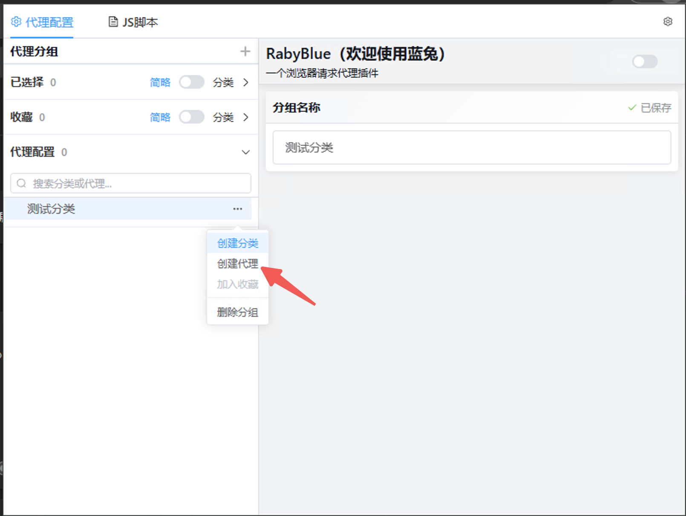
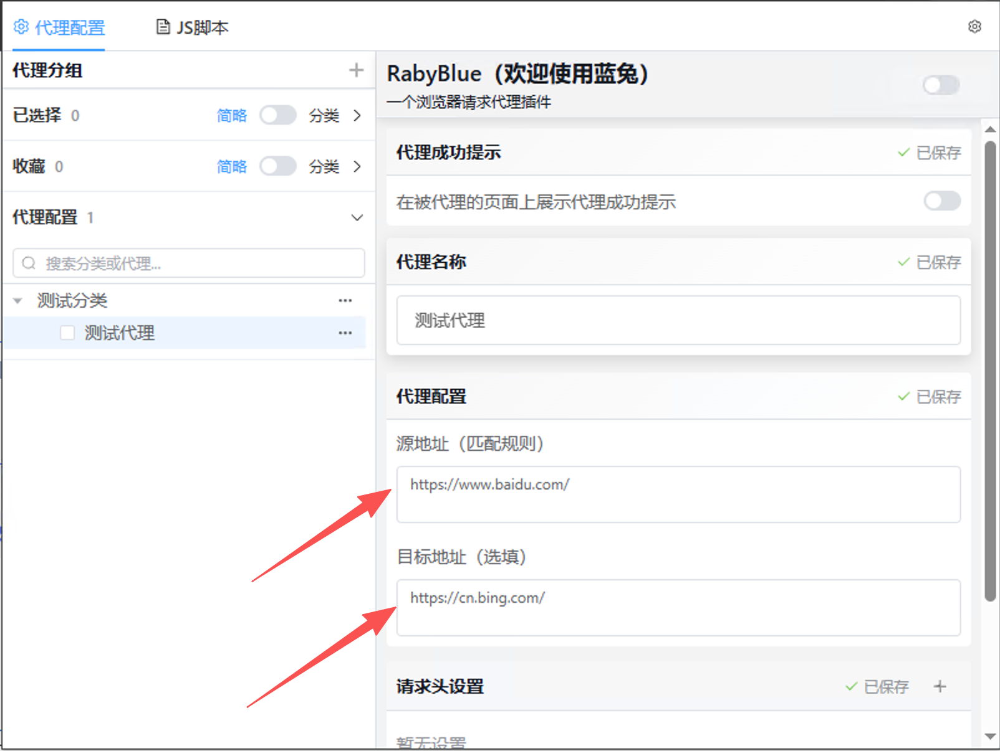
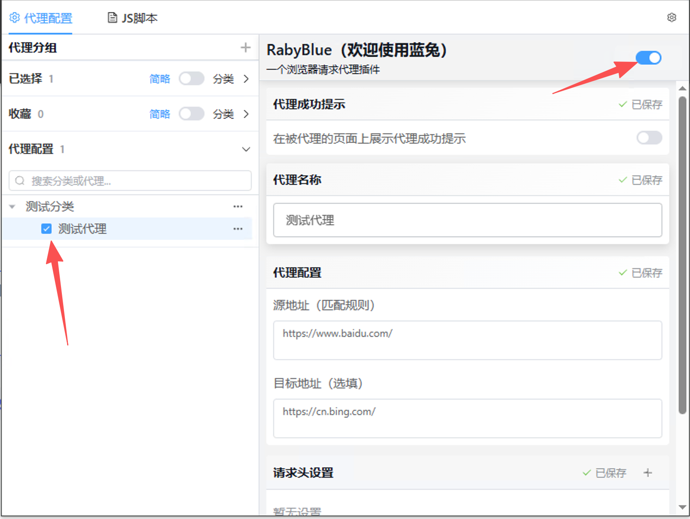
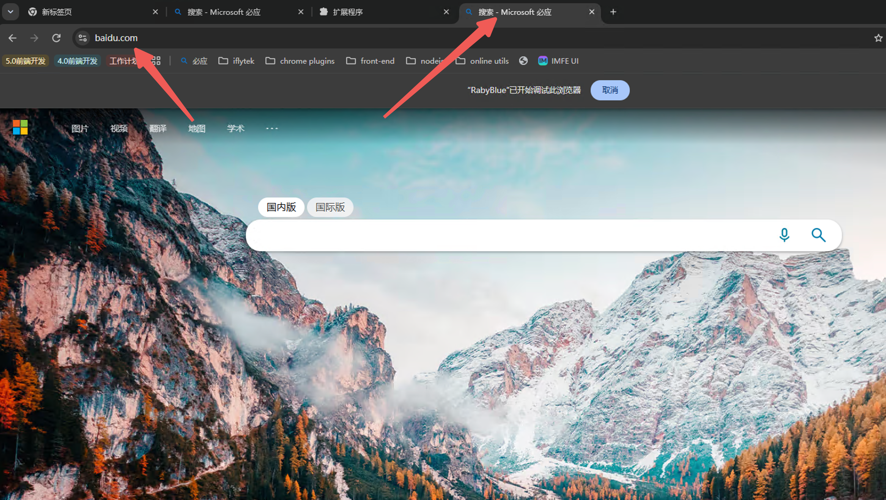
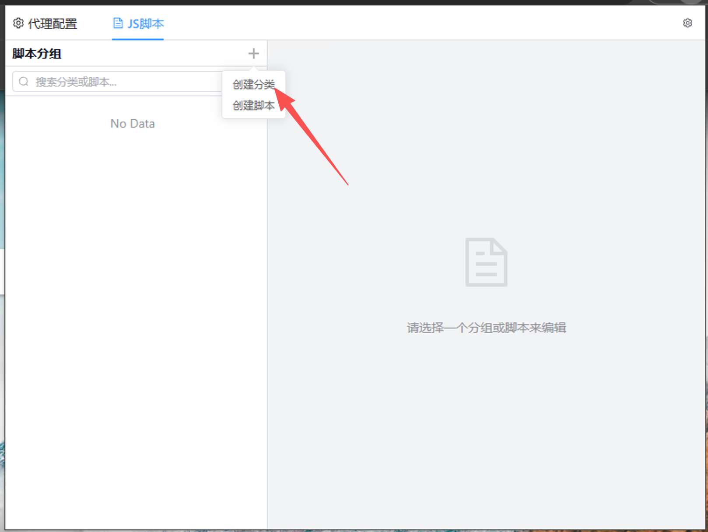
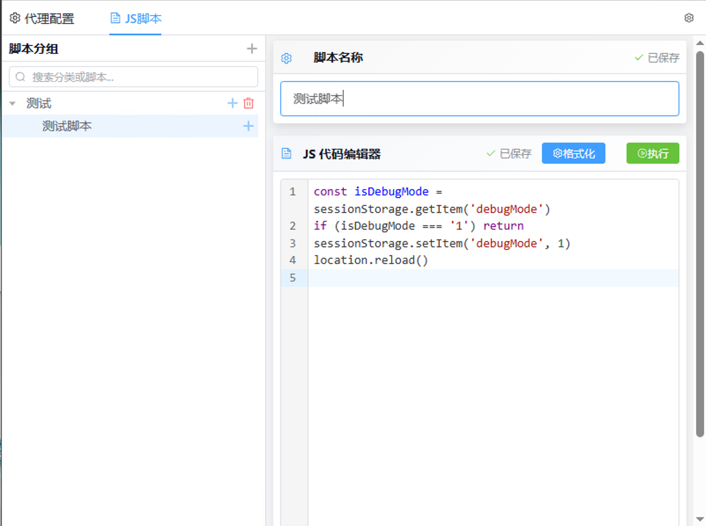

# Hi Guys 欢迎使用蓝兔

是的，是你想的那个蓝兔，虹猫正在开发中...

## 蓝兔是什么？

蓝兔是一个浏览器代理插件，为 WEB 研发调试而生！

您可以用它替换请求地址、增加或修改请求头和响应头，还可以管理一些调试时常用的 JavaScript 脚本。

少改点配置，少启动几个服务，把时间留给真正要解决的问题。蓝兔全心全意为您服务～

## 蓝兔解决哪些问题？

试想以下场景：

- 前端项目使用微前端，一个基座下挂着 10+、20+ 个子应用。应用还没启动几个，电脑内存就开始直呼吃不消，烦！

  要是能做到我修改哪个应用，就只启动哪个应用，我不改的全走线上环境就好了～

- 后端项目使用微服务，本地服务注册到 Nacos 之后，还得改请求地址，或者给请求增加自定义 Header，才能让网关把请求转发到本地。这两个操作都得改代码，调试完了还得改回去，麻烦不说还总是忘，烦！

  要是能不改代码就替换请求地址，或者给指定请求增加自定义请求头就好了～（网关需要支持对应的路由规则哦）

- 线上出问题了，同事发来控制台报错。生产环境关闭了 Source Map，错误信息、调用堆栈显示的都是压缩过的内容，看半天不知道错在哪，烦！

  要是能直接访问线上的地址，把有问题的前端应用切到本地代码，用本地的调试信息定位问题就好了～

- 线上问题修复之后，开发环境还没有数据测试，想造数据，业务流程比印度火车都长，烦！

  要是能在获得授权的情况下，用现有环境的数据辅助验证就好了～（不建议这么懒哦，该造数据还是得造的[旺柴]～）

- 我是测试，我的研发同事总说“我本地好得很啊，怎么就你那有问题？”之类的甩锅言语，烦！

  要是能直接连到他本地，用他的代码来跑就好了～（需要网络互通，还得让他的服务允许访问）

- 我有两台电脑，一台跑后端，一台跑前端，每次都需要改代码才能让前端请求我的后端，烦！

  要是能不改代码，就把指定请求转到另一台电脑上的服务就好了～（同样需要网络互通）

- 我有一些常用的 JavaScript 脚本，清除本地缓存、打开调试模式、一键填写大表单……每次想用，都得在控制台里按半天方向上键，才能翻到之前写的脚本，烦！

  要是能有个地方把这些脚本存起来，下次用的时候点击就能执行就好了～

上面这些内容，但凡**有一条与您的情况相符，蓝兔就能来帮忙**。蓝兔可以：

1. 通过配置，把匹配**源地址**的请求转向**目标地址**，不用为了临时调试来回改业务代码。
2. 给匹配的请求**增加或修改请求头、响应头**；只想修改头、不想换地址，也可以。
3. **导出、导入代理和脚本配置**，可以单独导出，也可以一起导出，方便分享给周围的同事。
4. 导入时默认**增量导入，同名项目保留您自己的配置**；需要整体替换时，再选择覆盖导入。
5. 把常用的 **JavaScript 脚本分类收好，需要时一键执行**，不用再翻控制台历史记录。
6. 将常用代理加入**收藏**，在**已选择**面板里查看当前勾选的代理，不用每次翻遍目录。
7. 在本地记住您的使用习惯，包括代理勾选状态、总控开关、分类展示模式，甚至面板折叠状态。

> 蓝兔帮您改的是请求，不是权限。请只调试自己有权访问的系统。连接线上环境前，先确认团队规范，尤其不要误点新增、删除、结算等会写入真实数据的操作；代理并不会自动隔离这些操作。

## 我该如何使用蓝兔？

### 先把蓝兔装到浏览器里

1. 如果您拿到的已经是构建好的 `dist` 文件夹，直接从下一步开始。如果您下载的是源码，需要先构建，命令放在后面的“我也想参与开发”里。
2. 在 Chrome 地址栏输入 [chrome://extensions/](chrome://extensions/)，打开扩展程序页。
3. 打开右上角的**开发者模式**。

   

4. 点击**加载已解压的扩展程序**，选择构建好的 `dist` 文件夹。选的是文件夹，不是里面的某个文件哦。
5. 点击 RabyBlue 图标，打开配置弹窗。如果工具栏里找不到，可以在浏览器的扩展程序菜单里把蓝兔固定出来。


### 再告诉蓝兔，您想代理谁

1. 先创建一个分类，把同一项目、同一环境的代理放在一起。
   
   

2. 在分类的操作菜单里，创建您需要的代理。

   

3. 填写代理名称、**源地址**和**目标地址**。如果需要给请求增加 Header，也在当前代理里配置。修改会自动保存。

   

4. **勾选代理，再打开总控开关**。只勾选、不打开总控，蓝兔还没有开始工作哦。

   

5. 刷新您正在调试的页面，蓝兔即可全心全意为您服务～

   

比如，我只想在本地启动一个子应用，可以这样配置：

```text
源地址：https://example.com/app/
目标地址：http://127.0.0.1:3000/app/

原请求：https://example.com/app/js/app.js
转向后：http://127.0.0.1:3000/app/js/app.js
```

本地服务要先启动，而且确实能返回对应文件。源地址、目标地址的路径也要对应起来，蓝兔不能替服务生成不存在的文件～

### JS 脚本收纳箱，常用代码也有个家

清缓存的、填表单的、打开项目调试开关的，把这些常用脚本收进来，下次就不用在控制台里翻来翻去了～

1. 切换到顶部的 **JS 脚本**，先创建一个分类。可以按项目或用途起名，为了后面好找，分类必不可少～

   

2. 在分类下创建脚本，填写**脚本名称**和**脚本代码**。名称起得直白一点，比如“开启调试模式”，下次一眼就知道它是干什么的。编辑后会自动保存，等状态显示“已保存”就收好了。

   

3. 打开您想操作的网页，再打开蓝兔，选中脚本，点击编辑器右上角的**执行**。脚本会在**当前活动标签页**运行，不是在蓝兔的配置弹窗里运行哦。

比如截图里的脚本，是给当前页面的 `sessionStorage` 设置一个调试标记，再刷新页面。这个标记需要您的项目自己支持，不是给所有网站都能开启调试模式的万能开关～

> 脚本保存不等于自动执行，需要您手动点击“执行”。清缓存、填表单等操作会影响当前页面，执行前先确认标签页和代码，尤其不要把不熟悉的脚本直接拿到线上跑。

## 蓝兔是如何实现的？

**蓝兔不是在您的电脑上偷偷启动了一个代理服务器，而是借助 Chrome 扩展提供的 API，按规则处理浏览器里的请求。**

主要用到这些能力：

| 要做的事                             | 使用的浏览器 API                                             |
| ------------------------------------ | ------------------------------------------------------------ |
| 重定向 JS、CSS、图片、字体和接口请求 | `chrome.declarativeNetRequest.updateDynamicRules`            |
| 改写页面文档的实际请求地址           | `chrome.debugger` 配合调试协议的 `Fetch.continueRequest`     |
| 增加或修改请求头、响应头             | 调试协议的 `Fetch.continueRequest`、`Fetch.continueResponse` |
| 在当前网页执行您保存的脚本           | `chrome.tabs.query`、`chrome.scripting.executeScript`        |
| 保存配置和使用习惯、监听配置变化     | `chrome.storage.local`、`chrome.storage.onChanged`           |

### 请求重定向：chrome.declarativeNetRequest

JS、CSS、图片、字体和接口请求，默认使用 **`chrome.declarativeNetRequest`**。

通过 `updateDynamicRules` 把源地址、目标地址等配置交给浏览器。浏览器发现请求匹配规则，就将它重定向到目标地址，不需要插件把每个文件都先下载一遍。

比如，把线上某个子应用的资源转到本地服务，其他未匹配的请求照常访问原来的地址。您只启动正在修改的应用就行～

[官方文档：declarativeNetRequest](https://developer.chrome.com/docs/extensions/reference/api/declarativeNetRequest)

### 页面文档改写：chrome.debugger + Fetch

直接打开一个页面时，如果也用普通重定向，地址栏可能就跟着跳到本地了。但我们想要的是：**访问的还是原来的地址，加载的却是本地服务返回的页面内容。**

这里使用 **`chrome.debugger`** 连接标签页，再通过 `sendCommand` 调用 **Chrome DevTools Protocol（CDP，Chrome 调试协议）** 的 `Fetch` 能力：

- `Fetch.enable`：开启请求拦截。
- `Fetch.requestPaused`：收到浏览器暂停请求的事件。
- `Fetch.continueRequest`：指定目标 URL，改写这次请求的实际地址，并让浏览器继续加载。

所以，**当前页面文档使用的是请求 URL 改写，不是插件先下载 HTML，再把内容塞回页面**。

这里识别的是浏览器标记的页面文档请求，包括页面和 iframe 文档，不是看地址有没有 `.html` 后缀。这里的 `Fetch` 是调试协议的一部分，也不是平时写 `fetch(url)` 发请求的那个 API 哦。

[官方文档：chrome.debugger](https://developer.chrome.com/docs/extensions/reference/api/debugger)、[调试协议：Fetch](https://chromedevtools.github.io/devtools-protocol/tot/Fetch/)

### 修改请求头、响应头：还是调试协议的 Fetch

请求头通过 **`Fetch.continueRequest`** 设置，响应头通过 **`Fetch.continueResponse`** 设置。同名头按配置覆盖，其他头尽量保留。

目标地址留空，或者和源地址相同，也可以只修改头，不切换服务。不过，不是所有头都能随便改，蓝兔会校验部分受保护的头。

如果文档代理同时设置了请求头，请填写**不再继续跳转的最终目标地址**。

### 执行 JS 脚本：chrome.scripting.executeScript

先用 **`chrome.tabs.query`** 找到当前窗口的活动标签页，再用 **`chrome.scripting.executeScript`** 把代码放到这个页面的主环境中执行。

这也是为什么脚本可以操作当前网页、访问页面的本地存储。它不是在蓝兔弹窗里运行，也不是一个安全沙箱，执行前记得确认当前网页和代码哦。

[官方文档：scripting](https://developer.chrome.com/docs/extensions/reference/api/scripting)

### 记住您的配置：chrome.storage.local

代理、脚本和用户偏好通过 **`chrome.storage.local.get`、`chrome.storage.local.set`** 读取和保存；**`chrome.storage.onChanged`** 用来监听配置变化，让代理规则跟着更新。

这些配置保存在浏览器本地，不使用 `chrome.storage.sync` 同步到其他设备。

但这不代表代理时不会发网络请求：**被代理的请求仍会发到您配置的目标服务**。导出文件也可能包含内网地址、令牌或脚本内容，分享前先检查一下，别把秘密一起送出去了～更多说明见 [隐私说明](PRIVACY.md)。

[官方文档：storage](https://developer.chrome.com/docs/extensions/reference/api/storage)

### 为什么会出现“蓝兔开始调试此浏览器”的提示？

因为页面文档改写和头设置用到了 **`chrome.debugger`**，Chrome 会展示调试提示。这不是蓝兔报错，也不是网页里的弹窗。

如果您在提示条上**取消了调试，蓝兔会关闭代理总控；需要继续使用时，再手动打开总控即可**。浏览器内部页面等受保护页面不能像普通网页一样处理。

## 使用时，还有几个小提醒

- **蓝兔不会自动解决所有跨域问题。** 非文档请求默认仍使用重定向，CORS、本地网络访问限制、混合内容检查等仍可能生效。
- **给 HTML 设置允许跨域的响应头，不代表 JS、字体、接口也被放行。** 它们是各自独立的请求，需要检查实际失败的那条请求。
- **跨电脑访问时，`127.0.0.1` 指的是运行浏览器的那台电脑。** 想访问同事或另一台电脑上的服务，要填对方可访问的地址，并确认监听地址、防火墙和网络连通性。
- **蓝兔不会给代码补上 Source Map。** 使用本地代码定位问题，也需要本地项目提供相应的调试信息。
- **只运行您信任的脚本。** JS 脚本在当前页面环境中执行，不是一个与页面隔离的安全沙箱。

## 我也想参与开发

欢迎欢迎～作者是 **RikHe**，仓库地址在这里：[RikHe-2017/raby-blue](https://github.com/RikHe-2017/raby-blue)。

使用 Node.js **22.21.1 或更新版本**，依赖统一使用 npm：

```bash
git clone https://github.com/RikHe-2017/raby-blue.git
cd raby-blue
npm ci

# 启动开发服务，在 Chrome 扩展程序页加载 dist-dev 文件夹
npm run dev

# 构建生产版本，生成 dist 文件夹
npm run build
```

开发模式需要保持服务运行。只是安装、使用蓝兔的话，加载构建好的 `dist` 就行，不需要一直开着开发服务。

提交修改前，可以跑一下检查：

```bash
npm test
npm run test:typecheck
npm run lint:check
npm run build
```

发现问题欢迎提 [Issue](https://github.com/RikHe-2017/raby-blue/issues)，记得附上复现步骤。截图和日志先脱敏，涉及安全的问题请参考 [安全政策](SECURITY.md)，不要直接把令牌或私钥贴出来哦。
